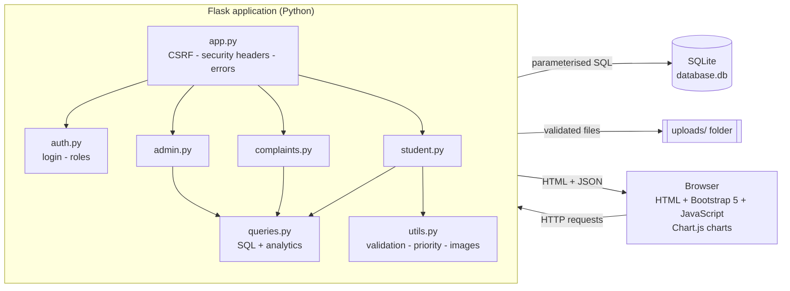
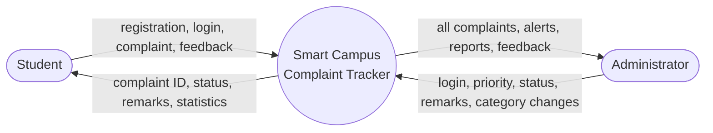
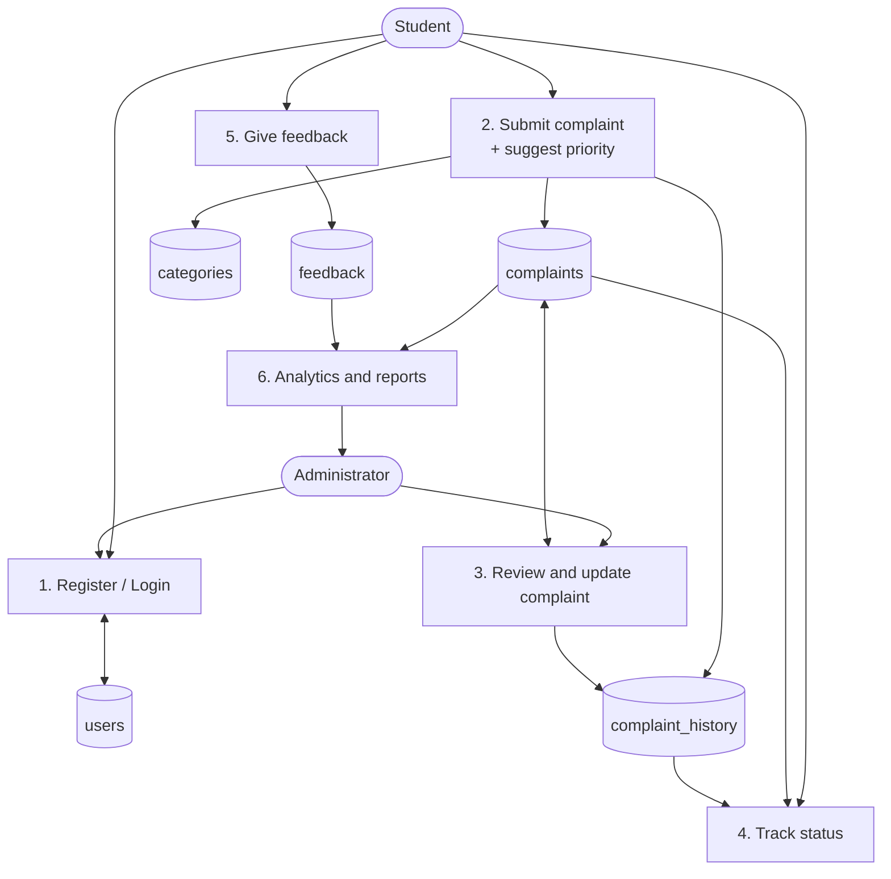
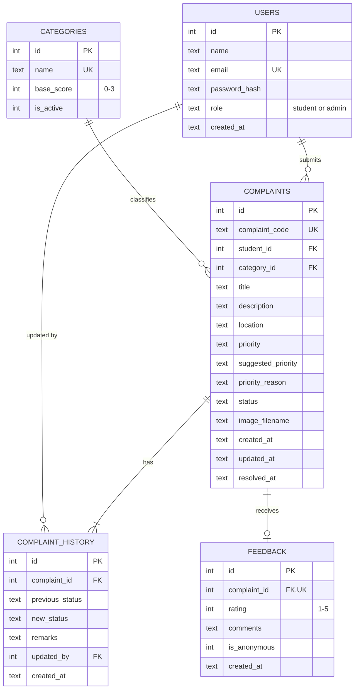

# Smart Campus Complaint & Solution Tracker
**A Minor Project Report**

Submitted by: *<Your Name, Roll No.>* · Guide: *<Guide Name>* · Department: *<Department>* · College: *<College Name>* · Year: *<Year>*
GitHub: *<your repository link>*

---

## 1. Abstract
Colleges often receive complaints about classrooms, electricity, Wi-Fi, laboratories and cleanliness verbally or through informal messages, which makes them hard to track and easy to forget. This project is a centralised web application built with Flask and SQLite in which students register, submit complaints (with an optional photo) and follow each complaint's progress, while administrators prioritise, update and analyse them. A rule-based **smart priority recommendation**, a complete **status history**, **anonymous feedback**, an **urgent-complaint alert** and **resolution-time analytics** make the system more useful than a simple complaint form. The application is secured with hashed passwords, role-based access, CSRF protection, parameterised queries and validated uploads, and is verified by 55 automated tests.

## 2. Introduction and Problem Statement
Complaints raised verbally or on chat groups have no unique reference, no owner, no history and no statistics. Students do not know whether anyone has seen their complaint; administrators cannot see which problems are urgent or how long fixes take.
**Problem:** develop a centralised web application where students can submit complaints, track status and read updates, and administrators can manage complaints, assign priorities, update resolution status and analyse statistics.

## 3. Objectives and Scope
**Objectives**
1. Provide one place to submit and track campus complaints with a unique ID.
2. Give students transparent, step-by-step progress information.
3. Help administrators focus on urgent issues through priority suggestions and alerts.
4. Measure performance through resolution-time and trend analytics.
5. Keep student data private and the application secure.

**Scope:** a single-college web application with two roles (student, administrator), complaint life-cycle management, image attachments, feedback and reports.
**Out of scope:** e-mail/SMS/push notifications, mobile app, password reset by e-mail, multi-college support.

## 4. Existing System and Proposed System
| Existing system | Proposed system |
|---|---|
| Verbal complaints, paper notes, chat messages | Online form with unique complaint ID |
| No history or proof | Time-stamped history of every status change |
| Priority decided ad hoc | Suggested priority (category + keywords), admin can override |
| No statistics | Dashboard, monthly report, resolution-time analytics |
| No feedback | Rating and (optionally anonymous) comments after resolution |

## 5. Requirements
### 5.1 Functional requirements
| ID | Requirement |
|---|---|
| F1 | Students can register and log in securely |
| F2 | Students can submit complaints (title, description, category, location, optional image) |
| F3 | System generates a unique complaint ID |
| F4 | Students can view, filter (category/date/status) and track their own complaints and admin remarks |
| F5 | Students can submit feedback after a complaint is resolved |
| F6 | Admin logs in with role-based access |
| F7 | Admin can view, search and filter all complaints |
| F8 | Admin can set priority (Low/Medium/High/Urgent) and status (Pending/In Progress/Resolved) and add remarks |
| F9 | Admin can view students and manage categories |
| F10 | System shows statistics, charts, monthly reports and average resolution time |
| F11 | System records the history of every update |
| F12 | System suggests a priority and highlights urgent complaints |

### 5.2 Non-functional requirements
Security (hashing, CSRF, RBAC, validation) · Usability (responsive, clear status labels) · Reliability (foreign keys, constraints, validated input) · Maintainability (modular code, comments, tests) · Performance (indexed tables; suitable for thousands of complaints) · Portability (runs on Windows/Linux/macOS with Python).

### 5.3 Software and hardware requirements
| Software | Hardware (minimum) |
|---|---|
| Windows 10/11 (or Linux/macOS) | Dual-core processor |
| Python 3.10+, Flask 3, python-dotenv | 4 GB RAM |
| SQLite 3 (bundled with Python) | 500 MB free disk |
| Browser (Chrome, Edge, Firefox) | Internet for CDN files (Bootstrap, Chart.js) |
| VS Code, Git/GitHub | |

## 6. System Architecture

**Workflow:** the student submits a complaint → the app validates it, suggests a priority, stores it with status *Pending* and writes the first history entry → the admin sees it (urgent ones are highlighted), reviews the priority, updates status and remarks → every change is written to the history → the student sees the timeline → after *Resolved* the student may give feedback → analytics update automatically.

## 7. Data-Flow Diagram
**Level 0 (context)**

**Level 1**

## 8. ER Diagram

## 9. Database Table Descriptions
**users** – every account. `role` is restricted to `student` or `admin`; `email` is unique; only a password **hash** is stored.
**categories** – admin-managed complaint types. `base_score` (0-3) is the starting urgency for the priority recommender; categories are deactivated, never deleted.
**complaints** – the main table. `complaint_code` (e.g. `CMP-2026-00012`) is unique; `priority` and `status` have CHECK constraints; `suggested_priority`/`priority_reason` keep what the recommender said even if the admin changes the final priority; `resolved_at` is filled when the status becomes *Resolved* (used for resolution time).
**complaint_history** – one row per submission/update (previous status, new status, remarks, who, when). Deleted automatically with its complaint (`ON DELETE CASCADE`).
**feedback** – at most one row per complaint (`UNIQUE complaint_id`), rating 1-5, optional comment, `is_anonymous` flag.
*Note:* the brief lists a `category` column in `complaints`; this project uses `category_id` (a foreign key to `categories`) because categories are admin-managed.

## 10. Module Descriptions
| Module | File | Responsibility |
|---|---|---|
| Application core | `app.py`, `config.py`, `db.py` | create the app, CSRF check, security headers, error pages, DB connection and first-run setup |
| Authentication | `auth.py` | register, login (session), logout, `login_required`, `student_required`, `admin_required` |
| Student | `student.py` | dashboard, filtered complaint list, complaint submission with validation and image upload |
| Shared complaint pages | `complaints.py` | complaint details + timeline, feedback, permission-checked image delivery |
| Administrator | `admin.py` | dashboard + urgent alerts, search/filter, status/priority/remarks update, students, categories, feedback, reports, CSV export |
| Analytics | `queries.py` | totals, category counts, 12-month trend, priority mix, average resolution time, monthly report |
| Utilities | `utils.py` | input cleaning, password rules, **priority recommendation**, image validation, date/duration formatting |
| Front end | `templates/`, `static/` | Bootstrap 5 pages, blue/white theme, Chart.js charts |

### Original features in detail
1. **Resolution-time analytics** – `AVG(julianday(resolved_at) − julianday(created_at)) × 24` hours, shown overall, per month and per category.
2. **Smart priority recommendation** – `score = category base score + 3 (critical word such as fire, spark, gas leak) + 1 per "problem" word such as not working/broken/exam (max +2) − 1 (minor word)`. Score ≥5 Urgent, ≥3 High, ≥1 Medium, else Low. The reason is stored and displayed; the admin can change the priority.
3. **Transparent tracking** – `complaint_history` timeline visible to the student.
4. **Anonymous feedback** – when ticked, the admin feedback page shows neither the student's name nor the complaint ID. (Limitation: the link to the complaint still exists inside the database.)
5. **Urgent alerts** – a red banner on the admin dashboard lists unresolved Urgent complaints; urgent rows are tinted in the table.
6. **Image attachments** – extension whitelist, magic-byte check, 2 MB limit, random file names, private delivery.

## 11. Security Measures
Password hashing (Werkzeug) · signed session cookie with HttpOnly/SameSite · session cleared on login · decorators for role-based access (403 for wrong role) · ownership check (404 for other students' complaints and images) · CSRF token on all POST forms · parameterised SQL · Jinja2 auto-escaping · input length/format validation · upload validation · security headers (CSP, nosniff, frame deny) · secrets only in `.env`.

## 12. Testing
Run: `python -m unittest discover -s tests -v` – **55 tests, all passed** (OK). In addition the application was started and exercised over real HTTP (login, complaint with image upload, admin pages, CSV, static files).

| # | Area | Test (examples) | Expected | Result |
|---|---|---|---|---|
| 1 | Registration/login | register + login; duplicate e-mail; weak password; mismatch | account created / errors shown | Pass |
| 2 | Invalid login | wrong password, unknown e-mail | same generic error | Pass |
| 3 | Password storage | DB row inspected | only hash stored | Pass |
| 4 | Role safety | self-register with `role=admin` | stays `student` | Pass |
| 5 | Complaint submission | valid form; invalid fields | saved / validation messages | Pass |
| 6 | Complaint ID | two complaints | `CMP-YYYY-00001`, `…00002` unique | Pass |
| 7 | Access restriction | student B opens/feedbacks student A's complaint | 404 | Pass |
| 8 | Unauthorized access | anonymous → protected pages; student → admin pages | redirect to login / 403 | Pass |
| 9 | CSRF | POST without/with forged token | 400 | Pass |
| 10 | Status update | Pending → In Progress → Resolved | status + `resolved_at` set | Pass |
| 11 | History | after the above | 3 history rows in order, remarks visible to student | Pass |
| 12 | Resolution note | resolve without note | rejected | Pass |
| 13 | Priority recommendation | 6 rule cases, word boundaries, stored reason | expected levels | Pass |
| 14 | Image upload | valid PNG; `.exe`; fake PNG content; >2 MB; empty; traversal | accept / reject; no stray files | Pass |
| 15 | Image privacy | other student / anonymous / admin | 404 / login / 200 | Pass |
| 16 | Feedback | before resolution; once only; rating validation | blocked / accepted / rejected | Pass |
| 17 | Anonymous feedback | admin list | no name, no complaint ID | Pass |
| 18 | Statistics | 3 complaints, known statuses, 6 h resolution | counts and 6.0 h average exact | Pass |
| 19 | Student stats isolation | two students | each sees only own totals | Pass |
| 20 | Reports/CSV | month report, invalid month, formula injection | correct / rejected / guarded | Pass |
| 21 | XSS / SQL injection | `<script>` title; `' OR '1'='1` search | escaped / no effect | Pass |

## 13. Advantages and Limitations
**Advantages:** one transparent system; unique IDs; full audit trail; priority guidance; analytics; secure by design; easy to run (no external services); well tested.
**Limitations:** no e-mail/SMS notification; no password reset; no login rate-limiting; priority recommendation is keyword based (not machine learning); no pagination; images are stored on local disk; Flask's development server is not for production; CDN files need internet.

## 14. Future Scope
E-mail/SMS/WhatsApp notifications · password reset · department-wise admins and complaint assignment to staff · SLA deadlines and escalation · PDF reports · mobile app · multi-language support · a trained text-classification model for priority · MySQL/PostgreSQL for large deployments · login attempt limiting and two-factor authentication.

## 15. Conclusion
The Smart Campus Complaint & Solution Tracker replaces informal complaint handling with a structured, transparent and measurable process. Students always know the state of their complaint; administrators can concentrate on urgent issues and see how quickly problems are solved. The modular Flask design, strong security practices and automated tests make the project reliable and easy to extend.

## 16. References
Flask documentation – <https://flask.palletsprojects.com> · SQLite documentation – <https://sqlite.org/docs.html> · Bootstrap 5 – <https://getbootstrap.com> · Chart.js – <https://www.chartjs.org> · OWASP Top 10 – <https://owasp.org/www-project-top-ten/> · Werkzeug security utilities – <https://werkzeug.palletsprojects.com>
